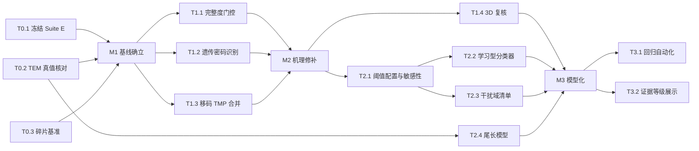

# 噬菌体结构与尾长预测：后续优化执行计划

> 状态：计划稿，未实施
> 编写时间：2026-11-21
> 代码基线：`58d50cb`（`test(phage-structure): 新增跨38科及在线NCBI双格式外部独立验证套件`）
> 适用模块：`src/analysis/phage_structure/`、`scripts/` 下结构预测相关脚本、`src/web-next/src/views/Analysis/modules/phage_structure/`

---

## 1. 背景与现状判断

1. 当前引擎是“序列同源（PHROG HMM / Pfam）+ 操纵子共线性规则”的专家系统，已去除样本级硬编码，但仍依赖人工设定的结构域清单与经验阈值。
2. 上一轮（步骤 58）的 3 处修复是在观察 Suite C / Suite D 报错后完成的，因此 **Suite C / D 已转为调参集，不再具备盲测效力**；修复后的 100% 不能作为泛化证据。
3. 已确认的机理缺口：
   - 全部验证样本均为完整基因组，碎片 Contig 与前噬菌体截断场景未经测试；“有头部、缺长尾 -> 短尾”的负向推断在截断片段上存在误判风险。
   - ORF 预测默认遗传密码 11，运行日志已出现 table 4 警告，重编码噬菌体存在截断风险。
   - 移码拆分 TMP（如 `NC_005178 D3112`，514 aa + 720 aa）只取单段，尾长误差达 47.47%。
   - 远缘巨型噬菌体（`phiKZ`、`MN871489 PaZh_1`）形态判对但 TMP 未检出。
   - 固定 0.145 nm/aa 存在系统低估（Suite B：肌尾平均偏差 -17.18 nm，长尾 -11.96 nm）。
4. TEM 真值存在质量问题：本轮 `NC_007458 Gamma` 曾误采检索摘要中的 118 nm，原文献为 200–217 nm。

## 2. 总体原则

1. **先测量、后修改**：任何规则改动前，必须先有冻结的基线数字。
2. **调参集与盲测集严格分离**：调参只允许使用 Suite A / B / C / D；新建的 Suite E 只在里程碑节点运行，运行结果不得用于改规则。若必须据此修改，则 Suite E 降级为调参集，并另建 Suite F。
3. **不引入样本级硬编码**：禁止按 Accession、PHROG 编号做特判；阈值集中配置并附依据。
4. **项目规则遵循**：模块化单一职责、相对路径、UTF-8 无 BOM、代码零 Emoji、中文文档、先测试后执行；批量处理使用 JSONL 分片断点；多核并行保留至少 2 个 CPU 核心；GPU 任务控制 batch size，并在切换引擎前执行显存回收。
5. **过程留档**：每个任务完成后，在 `docs/phage_structure_prediction_record.md` 追加步骤记录，只写实际运行得到的数字。

## 3. 阶段与任务

### 阶段 0：评估体系加固（P0，优先执行）

#### T0.1 冻结盲测集 Suite E
- **目标**：获得一套修复全程未接触过的样本，用于衡量真实泛化。
- **内容**：
  1. 在 `scripts/validation_datasets.py` 中新增 Suite E 构建函数：排除集合 = Suite A + B + C + D + 单元测试保留株，脚本内断言交集为 0。
  2. 本地部分：从剩余配对样本中按形态分层抽样（建议每形态 50 株，按科轮转、宿主分散）。
  3. 外部部分：通过 NCBI Entrez 按发布日期筛选晚于 INPHARED 数据版本（`9Aug2025`）的新噬菌体，补充 20–30 株。
  4. 生成 `manifest.json`，记录每个 `.fasta` / `.gbk` 的 SHA256，冻结后不再修改名单。
- **产出**：Suite E 清单与哈希；FASTA / GBK 双格式基线报告（只记录，不调参）。
- **验收**：交集断言通过；哈希可复核；报告包含准确率、Macro-F1、双格式一致率、假 TMP 率、有尾 TMP 召回率。

#### T0.2 TEM 尾长真值核对
- **目标**：保证定量回归的真值可追溯。
- **内容**：
  1. 新建版本化真值表（建议 `tests/fixtures/phage_structure/tem_truth.tsv`；已用 `git check-ignore` 确认该路径不被 `.gitignore` 拦截），字段：名称、Accession、形态、尾长 nm、范围、测量状态（伸展 / 收缩）、是否含基板、测量方法（负染 TEM / Cryo-EM）、文献 DOI、核对状态、备注。
  2. 将 `scripts/benchmark_phage_structure.py` 中的 `TEM_REFERENCES` 与 `scripts/validation_datasets.py` 中的 `SUITE_D_EXTERNAL_CASES` 迁移为读取该表。
  3. 逐条回查原始文献；无法找到出处的记录标记为“未核实”，不纳入定量回归，只参与形态评估。
- **验收**：Suite B + D 每条定量记录都有 DOI 或明确标记；用核对后的真值重算 Pearson r、MAE、MAPE，并与旧值并列记录。

#### T0.3 碎片 Contig 与前噬菌体基准
- **目标**：量化截断场景下的误判率，为 T1.1 提供依据。
- **内容**：
  1. 新建 `scripts/benchmark_fragmented_contigs.py`：从 Suite A / C 完整基因组切出 5 / 10 / 20 / 30 / 40 kb 滑动片段；额外构造“仅头部包装区 + 裂解区”和“仅尾部区”的定向截断样本。
  2. 前噬菌体场景：将噬菌体序列嵌入 `F:\Phage data\benchmarks\blind_sota_clinical` 中的宿主基因组片段，再截取含部分边界的窗口。
  3. JSONL 分片断点；多核运行时保留至少 2 个 CPU 核心。
- **指标**：按片段长度统计判为 `Incomplete` 的比例；来自肌尾 / 长尾基因组的片段被误判为 `Podoviridae-like` 的比例；含完整尾部模块片段的形态准确率。
- **验收**：形成基线数字表，本任务只测量、不设达标线。

### 阶段 1：机理缺口修补（P1）

#### T1.1 基因组完整度门控（依赖 T0.3）
- **内容**：
  1. 先确认 WSL 环境中 CheckV 是否可用（`F:\Phage data\benchmarks\unseen_real_genomes\checkv_out` 存在历史产物，需要复核当前可调用性）。
  2. 新建独立模块（建议 `completeness_gate.py`）：优先使用 CheckV 完整度；不可用时退化为末端重复（DTR / ITR）检测加核心模块完备度的启发式判断。
  3. 只有门控通过时，`morphotype_classifier.py` 中的 `HEAD_PRESENT_LONG_TAIL_ABSENT` 才允许加分；未通过时输出 `Incomplete`，或保留短尾倾向但降低置信度并给出警告。具体策略按 T0.3 数据决定。
- **验收**：碎片片段误判为短尾的比例较 T0.3 基线明显下降；Suite A 不新增错误；Suite B 形态与 TMP 结果不变。

#### T1.2 遗传密码自动识别
- **内容**：
  1. 新建独立模块（建议 `genetic_code_selector.py`）：分别用 11 / 4 / 15 号密码表预测 ORF，以编码密度和平均 ORF 长度选择最优密码表；评估 `pyrodigal-gv` 是否可在 `.venv` 中安装使用。
  2. 将选中的密码表写入结果数据结构（`types.py`）并在前端展示。
  3. 从 NCBI 检索已报道使用 table 4 / 15 的噬菌体，组建不少于 10 株的专项测试集。
- **验收**：专项集上 TMP 与结构蛋白长度不再出现提前截断；Suite A + C 的标准基因组仍选择 11 号密码表（选择准确率不低于 99%）。

#### T1.3 移码拆分 TMP 合并
- **内容**：
  1. 新建独立函数或模块（建议 `tmp_split_merger.py`），合并条件：同链相邻、重叠或间隔不超过约 100 bp；两段分别覆盖 TMP 的 N 端 / C 端结构域（如 PF06791 与 PF09718），或均带直接 TMP 结构域；合并后长度处于合理范围。
  2. 明确排除尾组装伴侣蛋白（gpG / gpGT 程序性移码）与 TMP 的误合并。
  3. 新增证据类型 `merged_split_tmp`（需扩展 `types.py` 与前端标签）。
- **测试先行**：D3112 型合成正例；TAP + TMP 相邻负例；两个无关长蛋白相邻负例。
- **验收**：D3112 尾长误差下降；在 Suite A / B / C / D 中统计全部触发合并的样本并逐一人工复核，确认无误合并。

#### T1.4 3D 结构复核（Phold / Foldseek）
- **内容**：
  1. 通过 `sequence_annotator.py` 中现有的 `check_phold_ready()` 确认环境可用性。
  2. 只对两类不确定样本触发：已判为有尾但无 TMP；形态得分第一与第二差距过小。
  3. GPU 运行时控制 batch size，切换计算引擎前执行显存回收，禁止显存溢出到共享内存。
- **验收**：记录 `phiKZ`、`PaZh_1` 的 TMP 是否被找回；记录额外耗时；已有高置信 TMP 的样本结果不得改变。

### 阶段 2：阈值与模型化（P2）

#### T2.1 阈值集中配置与敏感性分析
- **内容**：
  1. 将散落的经验阈值（`Z=200`、`sc>=50.0`、400 / 500 / 650 aa、`hmm_score>=60`、窗口 4 / 8、`2.6 vs 2.2` 等）集中到独立模块（建议 `thresholds.py`，使用不可变数据类），每项附依据说明。
  2. 新建 `scripts/sensitivity_phage_structure.py`：逐项上下浮动 ±20%，只在调参集（A / B / C / D）上统计准确率与 TMP 指标变化。
- **验收**：输出各阈值敏感度排名；对高敏感阈值给出加固建议。

#### T2.2 学习型形态分类器（与规则引擎并行）
- **内容**：
  1. 以模块计数矩阵、连接器类型、PhageTailFinder 簇特征为输入，在 INPHARED 科级标签上训练逻辑回归 / 梯度提升树。
  2. 按科或属分组交叉验证，防止近亲泄漏；训练数据排除 Suite E。
  3. 输出校准概率（可靠性曲线 / ECE）；规则引擎保留为可解释兜底，两者不一致时给出提示。
- **验收**：分组交叉验证 Macro-F1 不低于规则引擎，且校准误差可接受；最终在 Suite E 上运行一次并记录。

#### T2.3 数据驱动的干扰域清单
- **内容**：统计大规模已注释基因组中各 Pfam 在“TMP 位置”与“非 TMP 位置”的富集程度，生成候选干扰域 / 融合域清单。
- **验收**：输出候选清单并经人工复核后才可并入；不得自动生效。

#### T2.4 尾长模型改进（依赖 T0.2）
- **内容**：在核对后的 TEM 真值扩充到至少 60 株之后，比较固定 0.145 nm/aa、全局线性拟合、分形态线性拟合三种方案的留一法误差，并输出预测区间。
- **参考数据**（当前 Suite B）：固定系数 ≤2500 aa 时 MAE 15.7 nm；线性拟合留一法 MAE 13.23 nm；分形态留一法 MAE 14.55 nm。
- **验收**：只有留一法误差明确优于固定系数且无形态系统偏差时才切换；否则维持现状并展示区间。

### 阶段 3：工程化与展示（P3）

#### T3.1 回归基线自动化
- 新建统一回归入口（建议 `scripts/run_phage_structure_regression.py`），批量运行 A / B / C / D，与冻结结果逐株比对，输出差异明细（形态变化、TMP 长度变化、新增 / 消失的 TMP）。Suite E 只在里程碑节点单独运行。

#### T3.2 证据等级与风险提示展示
- 结果页区分“直接 TMP 结构域 / 共线性推断 / 疑似”三档证据，并在出现移码合并、非 11 号密码表、完整度门控未通过时显示提示。
- 涉及 `types.py`、`manager.py`、`StructureResults.vue`、`StructureHistory.vue`、`TailMorphotypeDiagram.vue`；需补充 vitest 用例并通过 `npm run build`。

## 4. 依赖关系与执行顺序

| 里程碑 | 包含任务 | 规模估计 | 结束时动作 |
|---|---|---|---|
| M1 基线确立 | T0.1 / T0.2 / T0.3 | 中 | Suite E 首次运行并记录；输出碎片误判基线 |
| M2 机理修补 | T1.1 / T1.2 / T1.3 | 中 | 全量回归 A–D；Suite E 第二次运行 |
| M3 模型化 | T1.4 / T2.1–T2.4 | 大 | 学习型分类器与规则引擎对比；Suite E 第三次运行 |
| M4 工程展示 | T3.1 / T3.2 | 小 | 前端测试与构建；整理提交 |

说明：T3.1 的回归入口可以提前到 M1 阶段先做简化版，便于后续每次改动都能快速比对。

## 5. 主要风险与应对

| 风险 | 影响 | 应对 |
|---|---|---|
| Suite E 被反复查看后失去盲测效力 | 泛化结论失真 | 每个里程碑只运行一次；若据此修改规则，立即降级并新建 Suite F |
| 外部新株缺乏可靠形态标签 | 评估噪声 | 只纳入有文献 TEM 或 ICTV 科级明确形态的样本，其余仅做双格式一致性统计 |
| CheckV / pyrodigal-gv / Phold 环境不可用 | T1.1 / T1.2 / T1.4 受阻 | 先做可用性检查；不可用时采用文中写明的退化方案，并如实记录 |
| 完整度门控误伤完整短尾基因组 | 短尾召回下降 | 以 Suite A / C 中全部短尾株为回归约束，不允许新增错误 |
| 学习模型在远缘科上过拟合 | 新科误判 | 分组交叉验证；规则引擎兜底；两者不一致时提示 |
| GPU 显存溢出 | 主机卡顿或 PCIe 阻塞 | 控制 batch size；引擎切换前执行显存回收；监控显存峰值 |

## 6. 待确认事项

1. Suite E 规模：本地每形态 50 株、外部 20–30 株是否合适。
2. 完整度门控未通过时的输出策略：直接输出 `Incomplete`，还是保留短尾倾向并降低置信度。
3. 是否同意扩展数据结构与前端（新增 `merged_split_tmp` 证据类型、密码表字段、证据等级展示）。
4. T1.4 是否允许启用 GPU 运行 Phold / Foldseek。
